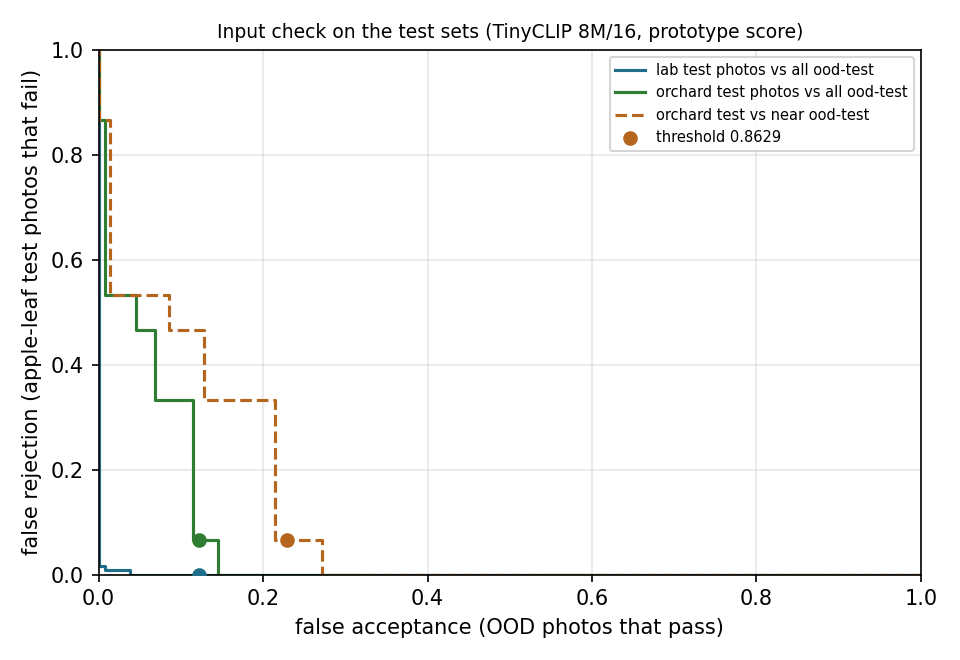

# Input check: evaluation of the shipped gate

Written by [`scripts/build_input_check.py`](../../scripts/build_input_check.py). Gate `frostguard-tinyclip-8m16-proto-1`: TinyCLIP ViT-8M/16 image embedding (the shipped ONNX file), cosine to the nearest of 7 prototypes (plantvillage:healthy, plantvillage:scab, plantvillage:black_rot, plantvillage:cedar_apple_rust, orchard:healthy, orchard:other_diseases, orchard:scab), threshold 0.862883: the highest value with at most 1% false rejection on the 130 tune photos. Test photos and ood-test played no part in any choice. Rates: percent (count; 95% Wilson interval).

## False rejection (apple-leaf photos the check turns away)

| Set | Tune | Test |
|---|---|---|
| PlantVillage (lab): black rot | 0.0% (0/30; 0.0 to 11.4) | 0.0% (0/30; 0.0 to 11.4) |
| PlantVillage (lab): cedar apple rust | 0.0% (0/30; 0.0 to 11.4) | 0.0% (0/30; 0.0 to 11.4) |
| PlantVillage (lab): healthy | 0.0% (0/30; 0.0 to 11.4) | 0.0% (0/30; 0.0 to 11.4) |
| PlantVillage (lab): scab | 0.0% (0/30; 0.0 to 11.4) | 0.0% (0/30; 0.0 to 11.4) |
| **PlantVillage, all** | | 0.0% (0/120; 0.0 to 3.1) |
| Orchard (Commons): healthy | 0.0% (0/4; 0.0 to 49.0) | 0.0% (0/5; 0.0 to 43.4) |
| Orchard (Commons): other diseases | 0.0% (0/4; 0.0 to 49.0) | 0.0% (0/7; 0.0 to 35.4) |
| Orchard (Commons): scab | 50.0% (1/2; 9.5 to 90.5) | 33.3% (1/3; 6.1 to 79.2) |
| **Orchard, all** | | 6.7% (1/15; 1.2 to 29.8) |
| Detector training data (PDD - Apple - Scab v1, all scab) | | 0.0% (0/200; 0.0 to 1.9) |
| **Tune photos, all** | 0.8% (1/130; 0.1 to 4.2) | |

## False acceptance (ood-test photos that pass)

| Category | Near or far | Passed |
|---|---|---|
| apple blossom | near | 0.0% (0/8; 0.0 to 32.4) |
| apple fruit | near | 12.5% (1/8; 2.2 to 47.1) |
| bark branches | near | 0.0% (0/8; 0.0 to 32.4) |
| cherry leaves | near | 14.3% (1/7; 2.6 to 51.3) |
| grape leaves | near | 50.0% (4/8; 21.5 to 78.5) |
| grass | near | 0.0% (0/8; 0.0 to 32.4) |
| maple leaves | near | 0.0% (0/8; 0.0 to 32.4) |
| other leaves | near | 57.1% (4/7; 25.0 to 84.2) |
| pear leaves | near | 75.0% (6/8; 40.9 to 92.9) |
| documents | far | 0.0% (0/8; 0.0 to 32.4) |
| everyday objects | far | 0.0% (0/8; 0.0 to 32.4) |
| hands | far | 0.0% (0/7; 0.0 to 35.4) |
| other animals | far | 0.0% (0/8; 0.0 to 32.4) |
| people | far | 0.0% (0/7; 0.0 to 35.4) |
| scenes | far | 0.0% (0/8; 0.0 to 32.4) |
| screenshots | far | 0.0% (0/8; 0.0 to 32.4) |
| sky | far | 0.0% (0/7; 0.0 to 35.4) |
| **All near** | near | 22.9% (16/70; 14.6 to 34.0) |
| **All far** | far | 0.0% (0/61; 0.0 to 5.9) |
| **All** | | 12.2% (16/131; 7.7 to 18.9) |

On ood-tune: near 15.4% (8/52; 8.0 to 27.5), far 0.0% (0/45; 0.0 to 7.9).

Passing ood-test photos: `set/apple_fruit/2018_07_15_green_apples_on_tree.jpg`, `set/cherry_leaves/prunus_avium_uk_5.jpg`, `set/grape_leaves/fieberiella_florii_nymph_on_a_vitis_vinifera_leaf_2.jpg`, `set/grape_leaves/vitis_vinifera_seedling_featuring_various_leaf_shapes.jpg`, `set/grape_leaves/vitis_vinifera_subsp_sylvestris_sl11.jpg`, `set/grape_leaves/vitis_vinifera_subsp_sylvestris_sl13.jpg`, `set/other_leaves/apricot_mallow_leaf_closeup.jpg`, `set/other_leaves/photinia_serratifolia_diplocarpon_mespili_fungus.jpg`, `set/other_leaves/walnut_leaf_galls_lower_surface_geograph_org_uk_4574421.jpg`, `set/other_leaves/walnut_leaf_galls_upper_surface_geograph_org_uk_4574415.jpg`, `set/pear_leaves/eriophyes_pyri_129.jpg`, `set/pear_leaves/eriophyes_pyri_on_sorbus_aria_wf3_3.jpg`, `set/pear_leaves/mycosphaerella_pyri_s1_2.jpg`, `set/pear_leaves/pear_leaves_with_stemphylium_vesicarium.jpg`, `set/pear_leaves/pear_rust_on_a_pear_tree.jpg`, `set/pear_leaves/stemphylium_vesicarium_on_pyrus_josephine_de_malines.jpg`.

AUROC against ood-test: lab test photos 0.9996, orchard test photos 0.9450.

## Shipped sample leaves

5 of 7 pass.

## Post-hoc observations

Not used for any choice. On ood-test photos, without the input check the detector reported scab on 77.9% (102/131; 70.0 to 84.1) and the app called the leaf clean on 22.1% (29/131; 15.9 to 30.0). With the check in front: scab reported on 10.7% (14/131; 6.5 to 17.1), "no scab lesions found" on 1.5% (2/131; 0.4 to 5.4); every other photo gets the notice instead.
